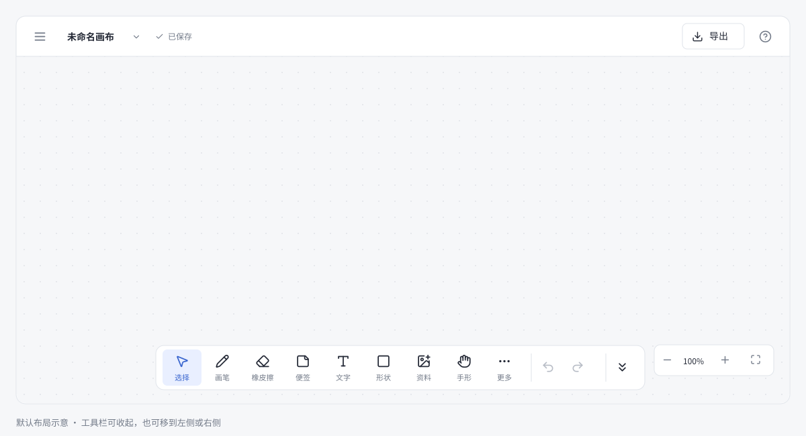

# CanvasNote

[English](README.md)

电脑和平板共用的本地画布笔记软件。收集学习资料、写笔记、打草稿，把内容放在一张无限画布上。



上图为布局示意。新建项目直接打开空白画布。

## 使用

**Windows：**完整解压便携版 ZIP，打开文件夹中的 `CanvasNote.exe`，保留整个文件夹的文件。运行时已包含在包里，不需要安装 Node.js。

**网页版与平板：**将生产构建的 `dist/` 部署到 HTTPS 静态服务器，在电脑或平板的浏览器打开。首次成功加载并缓存后可离线使用，支持添加到主屏幕。

操作说明和快捷键集中在 **Help** 中。通过**菜单 → 工具栏**选择底部、左侧或右侧；点双箭头收起，再点留下的小箭头展开。收起后仍可绘制和使用快捷键。

## 功能

- 无限画布、画笔、荧光笔、橡皮擦、便签、文字、基础形状和图片。
- PDF 指定单页导入，多选、组合、排列、锁定和图层管理。
- 撤销、重做放在绘图工具栏中；橡皮擦选项可一键清空当前画布，一次撤销即可恢复。
- 本机自动保存、多项目切换。
- 可编辑的 `.canvasnote` 项目文件，素材随文件打包；支持 PNG 导出。
- 浅色、深色、极光、电子外观，可上传背景图片；动态效果默认关闭。
- 演示区域与演示模式。
- 工具栏位置和收起状态在当前设备记忆，下次打开自动恢复。

项目和图片都在当前设备处理。网页与桌面版的数据分别保存，不会自动跨设备同步。迁移到另一台设备时，导出 `.canvasnote` 再导入；重要内容建议另存文件备份。

## 开发

需要 Node.js 22 或以上。

```sh
npm ci
npm run dev
npm test
npm run build
```

网页产物在 `dist/`，可部署到 HTTPS 静态服务器。

```sh
npm run package:windows
npm run package:source
```

发布 ZIP 写入 `release/`。Windows 打包会下载官方 Electron 运行时；也可把 `CANVASNOTE_RUNTIME_DIR` 设为已解压的可信运行时目录。

桌面开发先运行 `npm install --no-save electron@44.7.0`，再运行 `npm run desktop`。

编辑器使用 React、TypeScript、React Konva、Zustand、JSZip 和 PDF.js。`desktop/` 是便携版使用的 Electron 桥接代码；另附的 `src-tauri/` 为实验工程，尚未编译验收。

## 当前范围

橡皮擦删除整个对象。PDF 页面作为图片导入，没有整本 PDF 编辑或全文搜索。没有专业笔刷、压感、掌触拒绝、云同步或多人协作。

项目文件限制 100MB，单张导入图片限制 30MB，图片长边最多 4096px。PNG 在分配画布前限制为最长边 8192px、3200 万像素，不包含背景壁纸和动态效果。

50 项自动检查覆盖模型、文件、存储、手势、DOM 与原生 Canvas 集成；浏览器排版和 Windows、iPad、Android 实机仍待验收。具体范围见[验证记录](docs/VALIDATION.md)。

## 开源与发布

源码采用 [MIT 许可证](LICENSE)，第三方依赖见 [THIRD_PARTY_NOTICES.md](THIRD_PARTY_NOTICES.md)。贡献方式见 [CONTRIBUTING.md](CONTRIBUTING.md)，上传 GitHub 和首发文案见 [docs/RELEASE.md](docs/RELEASE.md)。
